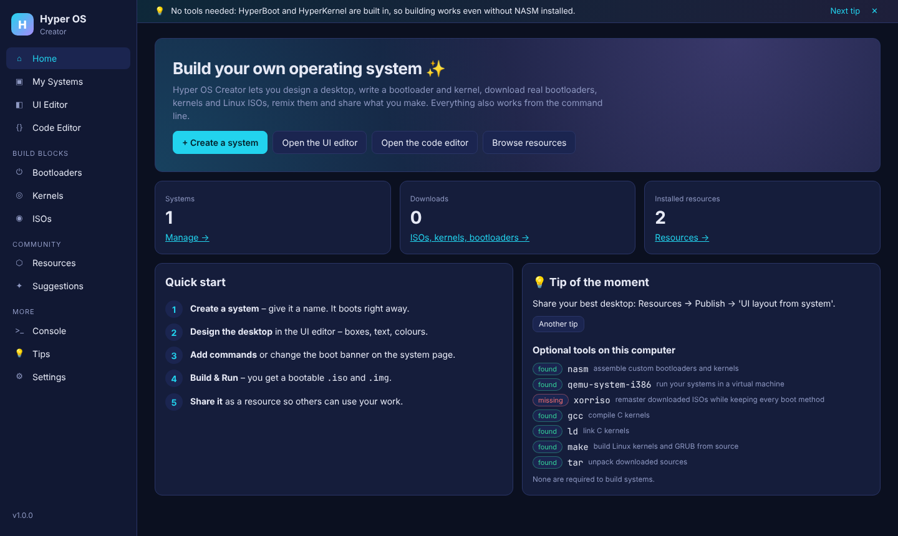
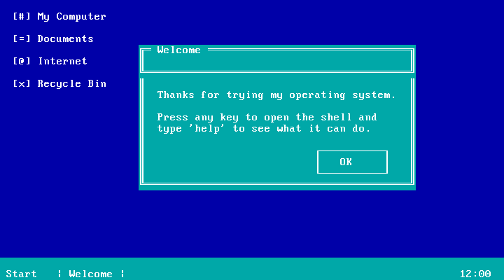
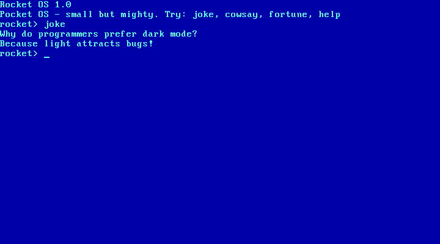
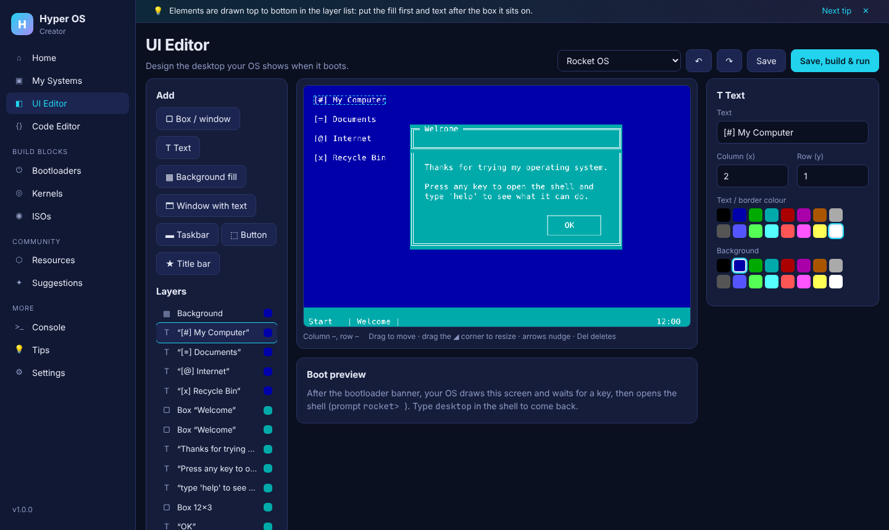
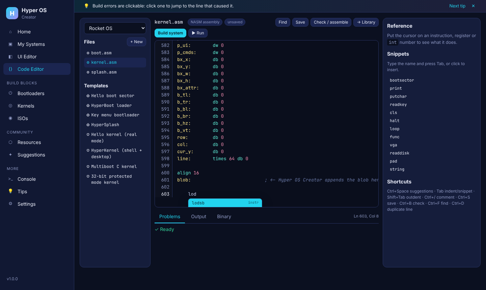

# Hyper OS Creator

Design, build, remix and share your own operating systems, from the first
boot sector to the desktop.

Hyper OS Creator is a web app plus a command-line tool. With it you can:

| | |
|---|---|
| **Bootloaders** | Download real ones (GRUB, Limine, SYSLINUX, iPXE, rEFInd) or **create your own**: generate one with no tools, or write one in assembly with templates |
| **Kernels** | Download Linux kernels (kernel.org source or ready-to-boot prebuilt kernels), **write a custom kernel** (real mode, 32-bit protected mode or C) or **configure and build a custom Linux kernel** |
| **UI editor** | Drag-and-drop editor for your OS desktop: windows, text, colours, taskbars and buttons |
| **Code editor** | Syntax highlighting, autocomplete, snippets, instant x86/BIOS reference, auto-indent, find & replace and clickable build errors |
| **Custom systems** | Combine everything into a system that builds into a bootable `.iso` and `.img` with no external tools |
| **ISOs** | Download Alpine, Debian, Ubuntu, Arch or Tiny Core (checked against official checksums where published), look inside them, then **modify** them by adding, editing or removing files and rebuilding a bootable ISO |
| **Resources** | Get themes, desktop layouts, command packs, code snippets and whole system templates, and **publish** your own |
| **Feature suggestions** | Suggest ideas, vote on them and send them to GitHub as a pre-filled issue |
| **Command line** | Everything also works in a terminal: `hyperos …` or the interactive `hyperos shell` |
| **Tips** | Tips on every page, in the terminal (`hyperos tip`) and a full tips page |



## Quick start

You need **Python 3.9+**. No packages need installing.

```bash
git clone https://github.com/noahnoahg1234/Hyper-Os-Creator.git
```

```bash
cd Hyper-Os-Creator
```

```bash
./start.sh
```

On Windows, double-click **`start.bat`**. Your browser opens at <http://localhost:8642>.

1. Click **Create a system** and give it a name.
2. Design the desktop in the **UI Editor**.
3. Press **Build**. You get `build/<name>.iso` and `build/<name>.img`.
4. Press **Run in QEMU**, or boot the ISO in VirtualBox, VMware or on a real PC (BIOS / legacy boot).

| Your desktop, booted | The built-in shell |
|---|---|
|  |  |

### Optional tools

Building systems needs nothing extra. These tools unlock more features
(`hyperos doctor` shows which ones you have):

| Tool | Unlocks |
|---|---|
| `nasm` | Building custom bootloaders and kernels written in assembly |
| `qemu-system-x86` | The **Run** button: test systems in a virtual machine |
| `xorriso` | The most faithful ISO remastering (also keeps USB-stick boot) |
| `gcc`, `ld`, `make`, `flex`, `bison`, `bc` | C kernels and custom Linux kernel builds |

On Debian or Ubuntu:

```bash
sudo apt install nasm qemu-system-x86 xorriso build-essential flex bison bc
```

## The editors

**UI editor:** the screen is the real 80×25 VGA text mode, so what you see is exactly what
boots. Drag to move, drag the corner to resize, use the arrow keys to nudge, Ctrl+D duplicates
and Ctrl+Z undoes. Presets give you windows, taskbars, buttons and title bars.



**Code editor:** built for OS code (NASM assembly, C, Makefiles, JSON).

* Autocomplete for instructions, registers, directives and your own labels (Ctrl+Space)
* Snippets: type `bootsector`, `print`, `vga`, `readdisk`, … and press Tab
* A reference panel that explains the instruction, register or `int 0x10` under the cursor
* **Check** assembles your code and marks errors on the right lines, and checks that boot sectors are 512 bytes with a valid signature
* Auto-indent, bracket pairing, Ctrl+/ comments, find & replace, and a hex view of the output



## Command line

Everything in the app also works in a terminal. Use `python -m hyperos`, or after
`pip install .` just `hyperos`.

```bash
python -m hyperos system new "Rocket OS"
python -m hyperos system cmd-add rocket-os joke "Why did the kernel panic? It saw a null pointer!"
python -m hyperos system text-add rocket-os "Hello!" --x 30 --y 12 --fg yellow --bg blue
python -m hyperos system preview rocket-os      # draws the desktop in your terminal
python -m hyperos system build rocket-os
python -m hyperos system run rocket-os          # needs QEMU

python -m hyperos bootloader download limine
python -m hyperos bootloader splash "MY OS" "Booted from 512 bytes!"
python -m hyperos kernel releases
python -m hyperos kernel download alpine-virt
python -m hyperos kernel use pmode-kernel rocket-os

python -m hyperos iso download alpine-virt
python -m hyperos iso inspect ~/HyperOS/downloads/isos/alpine-virt-*.iso
python -m hyperos iso project new my-alpine ~/HyperOS/downloads/isos/alpine-virt-*.iso
python -m hyperos iso project add my-alpine /hello.txt ./hello.txt
python -m hyperos iso project build my-alpine

python -m hyperos resources search theme
python -m hyperos resources get retro-amber --registry bundled
python -m hyperos resources apply retro-amber rocket-os

python -m hyperos suggest add "Mouse support" -c kernel
python -m hyperos tip
python -m hyperos shell                         # interactive console with tab completion
```

Run `python -m hyperos --help` (or `--help` after any command) to see everything.

## Sharing resources

A resource is a `.hyperpkg` file (a zip with a `manifest.json`). Types are `theme`, `ui-layout`,
`command-pack`, `system-template`, `bootloader`, `kernel`, `snippet` and `iso-overlay`.

* **Get:** the Resources page searches every registry: your local one, the starter pack bundled
  in [`registry/`](registry) (works offline), and the registries listed in Settings. The default
  online registry is this repository's `registry/` folder on GitHub.
* **Publish locally:** publish to your own registry. Run `hyperos serve --host 0.0.0.0` and friends
  or classmates can add `http://<your-computer>:8642/registry` to their settings, browse your
  resources and publish to it.
* **Publish to the community registry:** choose "Just download the package" (or use
  `hyperos resources create`), copy the file into `registry/packages/`, run
  `python tools/build_registry.py` and open a pull request.

When the server is shared on a network, other computers can only browse and publish resources
and use the suggestion box. Everything that changes your systems and files works only on the
computer that runs Hyper OS Creator.

## How it works

```
 BIOS ─► HyperBoot (512-byte boot sector) ─► HyperKernel (16-bit, loaded at 0x1000:0000)
            banner, loads N sectors              draws your desktop, then runs the shell
```

* `hyperos/asm/` holds the NASM sources of **HyperBoot**, **HyperSplash** and **HyperKernel**.
  `hyperos/prebuilt.py` contains them pre-assembled, so no assembler is needed. Your system's
  name, prompt, desktop layout and commands are encoded into a data blob that is appended to
  the kernel.
* `hyperos/image.py` is a pure-Python ISO 9660 writer and reader (Rock Ridge long names, El Torito
  BIOS floppy and no-emulation boot, boot info tables, UEFI entries). The built ISO uses
  El Torito floppy emulation, so it boots on BIOS machines and VMs.
* `hyperos/server.py` is the web app's JSON API (standard library only) and `hyperos/web/` the
  single-page front end.
* Your work is stored in `~/HyperOS` (change it with the `HYPEROS_HOME` environment variable).

```
hyperos/            Python package (CLI, server, builders, ISO tools)
  asm/              HyperBoot / HyperSplash / HyperKernel sources
  templates/        bootloader and kernel templates for the code editor
  web/              the web app (HTML/CSS/JS, no build step)
registry/           starter resources + community registry index
tools/              build_prebuilt.py, build_registry.py
tests/              unit tests, including real boots in QEMU
```

### Known limits

* HyperBoot and HyperKernel target BIOS (legacy) boot. On UEFI-only machines, enable CSM/legacy
  boot or use a downloaded bootloader such as Limine or GRUB.
* Without `xorriso`, modified ISOs keep CD/DVD and VM boot (BIOS and UEFI El Torito) but not
  USB-stick (isohybrid) boot.
* Downloads come straight from each project's official servers, so they need internet access.

## Development

```bash
python -m unittest discover tests -v
```

The tests build systems and boot them in QEMU (when it is installed), reading the screen from VGA
memory. After editing `hyperos/asm/*.asm`, regenerate the prebuilt binaries:

```bash
python tools/build_prebuilt.py
```

## License

GPL-3.0. See [LICENSE](LICENSE).
